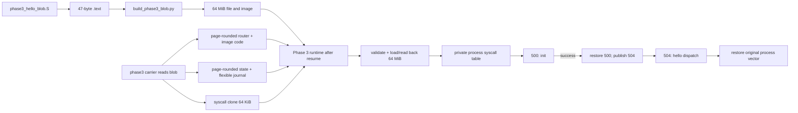

# Byepervisor Reborn Module Loader

This fork implements a small retained module loader for a regular retail PS5 on firmware 10.60. A **carrier** runs before and across the rest/resume transition so kernel allocations survive it; a fresh **runtime** process finds those allocations afterward, validates a separate position-independent **blob**, and exposes the blob only to that process through a cloned syscall table. Syscalls 500 and 504 provide a controlled init/hello demonstration without changing the global table.

Code is all AI, I didn't review a single character of it.

Only tested on 10.60.


## Ten-line orientation

1. `phase3_hello_blob.S` compiles into 47 bytes of position-independent demo code with init and dispatch entry points.
2. `build_phase3_blob.py` places that code in a 64 MiB v1 file whose mapped module image is also 64 MiB.
3. `byepervisor_reborn.elf` is the retail 10.60 release carrier; `phase3_carrier.elf` keeps the attended/demo protocol.
4. The carrier validates the target blob and journals one mapping leaf for every page in the rounded router-plus-image allocation.
5. `phase3_runtime_release.elf` is the release runtime; `phase3_runtime.elf` is its attended/demo counterpart.
6. The runtime copies and reads back the complete image, changes every code-region page to RX, synchronizes visibility, and re-walks every mapping.
7. It clones the current process's syscall vector and all 734 syscall entries; the stock global objects are not edited.
8. Private syscall 500 runs module init once; only after success does private syscall 504 become the hello dispatcher.
9. The hello handler returns errno in `EAX` and writes its application value to the current thread's `td_retval[0]`.
10. The runtime restores the process's original vector and releases the attachment, while retained backing stays pinned for discovery.

**The shipped Phase 3 artifact is literal:** the produced disk file is exactly 67,108,864 bytes; the mapped module image is independently exactly 67,108,864 bytes; the segment copies 67,108,656 file-backed bytes from file offset 208 and zeroes the remaining 208 image bytes as BSS. For this image, `phase3_prealloc_layout()` derives 67,112,960 bytes of code backing (a 4 KiB router page plus the image), 16,385 code pages, a 393,264-byte journal, and 401,408 bytes (`0x62000`, 392 KiB) of state backing. The runtime populates and reads back every shipped-image page, then verifies every final RX mapping. These values are derived from this producer's image, not format or carrier maxima.

**Live status:** an attended run on a regular retail 10.60 system completed with `PHASE3_RESULT status=0` and was accepted. It exercised the exact 64 MiB file and image, blob-derived retained layout, complete image copy/zero readback, journal validation, all-page RX publication and re-walk, init/hello dispatch and return value, original process-vector restoration, zero final attachments/inflight, and retained pinned state. The run's `notification-displayed` milestone was a machine protocol acknowledgment accepted for that interactive test; it is not a claim that a person visually observed the notification. That run used the prior Payload Manager blob path and the attended listener protocol. It does not validate `byepervisor_reborn.elf`, `phase3_runtime_release.elf`, or the new `/data/byepervisor/module-loader/phase3_hello.blob` placement.



## How the loader runs, in order

### 1. Build the blob

The Makefile compiles [phase3_hello_blob.S](phase3_hello_blob.S) as freestanding PIC, extracts only `.text` to `phase3_blob_code.bin`, and runs [build_phase3_blob.py](build_phase3_blob.py). The producer fixes `init_offset = 0` and `dispatch_offset = 16`; it is a demo packager, not a linker or symbol resolver.

The output in the working tree is:

```text
./phase3_hello.blob                 67,108,864 bytes (64 MiB file)
  header and tables                 file offsets [0,208)
  segment source                    67,108,656 bytes at file offset 208
  phase3_blob_init                  image offset 0
  phase3_blob_dispatch              image offset 16
  mapped module image               67,108,864 bytes (64 MiB)
```

`phase3_hello.blob` and the intermediate `phase3_blob_code.bin` are generated
and ignored by Git. `make -B phase3_hello.blob` recreates both from source.

The carrier and runtime do not use that host path directly. Both open the same
separately placed console file at exactly:

```text
/data/byepervisor/module-loader/phase3_hello.blob
```

Place this ordinary data file outside Payload Manager before executing the
carrier, and leave it unchanged at that path through resume and runtime
execution. The carrier reads it before rest/resume; the runtime opens the same
file afterward. Both reject a nonpositive or non-`size_t`-representable file
length and validate the mapped v1 blob. Before allocation, the carrier maps it
read-only, extracts `image_size`, and calls `phase3_prealloc_prepare()`. The
runtime later maps it privately read/write for its digest-negative check and
revalidates it. `phase3_prealloc_layout()` checked-rounds `0x1000 + image_size`
to a code allocation, creates one journal entry per code page, and
checked-rounds state offset `0x1000` plus the flexible journal to a state
allocation. No fixed format, file, image, or carrier-capacity maximum is
encoded; checked arithmetic, `size_t` representability, allocation success,
and safe page mappings are the limits.

### 2. Prepare retained backing before resume

The release carrier is `byepervisor_reborn.elf`; the attended/demo carrier is `phase3_carrier.elf`. Both are built with the Phase 2 carrier path because Phase 3 reuses Phase 2 ownership and attachment infrastructure. Before the transition, either carrier requests three typed allocations:

| Backing | Allocation rule | Shipped 64 MiB image |
| --- | --- | ---: |
| Code | `round_up(0x1000 + image_size, 0x1000)` | `0x4001000` (64 MiB + 4 KiB) |
| State | `round_up(0x1000 + 24 + page_count * 24, 0x1000)` | `0x62000` (392 KiB) |
| Clone | Fixed `0x10000` | 64 KiB |

Here `page_count = code_size / 0x1000`; the 24-byte journal header is followed by one 24-byte `phase3_code_page_entry_t` per code page. The preallocation record moves through `ARMED -> FIRED -> VERIFIED -> CONSUMED` and stores the derived sizes, page count, journal address, and checksum. Each entry contains a mapping-leaf address, its original value, and the final executable/read-only value. For the shipped blob the count is `0x4001` (16,385). The carrier restores every leaf it has prepared if allocation/journal preparation fails.

Phase 0 establishes the firmware/profile, mapping, temporary-call, and publication predicates. Phase 1 adds typed retained allocation records. Phase 2 adds the retained router, locator, ownership records, and process-local syscall attachment. Phase 3 consumes those contracts rather than creating a second allocator or attachment scheme.

### 3. Discover or install after resume

`phase3_runtime_release.elf`, or `phase3_runtime.elf` in an attended/demo run, first validates the exact retail 10.60 identity and the stock syscall baseline. It then reads the retained locator:

- A zero locator selects `p3_install()`: revalidate the blob, recompute code/state/page/journal sizes with `phase3_prealloc_layout()`, require an exact match with the carrier record, load the image, publish the locator, then attach and run.
- A valid nonzero locator selects `p3_resume()`: rediscover an existing LIVE Phase 2 router and a PREPARED Phase 3 module with matching generations, image identity, and digest.
- Any malformed, quarantined, attached, inflight, already-called, or non-PREPARED retained module is rejected by the resume path.

The 64 MiB file mapping remains user-process input. The shipped segment starts at file offset 208, copies all remaining 67,108,656 file bytes to image offset 0, and explicitly zero-fills the final 208 image bytes. The retained image starts at code offset `0x1000`; file metadata is not copied. `blob_file_size` and `image_size` are both 64 MiB, while `blob_address` is the retained image base rather than the mapped user-file address.

### 4. Validate, load, and publish the module

`phase3_blob_validate()` decodes untrusted bytes explicitly as little-endian records. The target runtime then uses `load_phase3_image()` to transfer each segment in at most 4 KiB chunks and read every chunk back. For the shipped blob this copies and verifies 67,108,656 bytes, then writes and verifies the 208-byte BSS tail as zeros.

For the shipped 64 MiB blob, the retained code region contains:

| Code offset/range | Content |
| ---: | --- |
| `0x000` | Generated init router, capacity `0x200` |
| `0x200` | Generated hello router, capacity `0x200` |
| `[0x400,0x1000)` | Zeroed remainder of the router page |
| `[0x1000,0x4001000)` | Exact 64 MiB loaded image |

Before publication, `validate_phase3_journal()` recomputes the dynamic layout and checks the allocation sizes, journal address, page count, header, checksum, and first-entry identity. A temporary private route writes every journaled final leaf value; the runtime performs all-core guest-TLB and instruction synchronization, then re-walks every code-allocation page and requires its expected level-4 leaf to be RX. Rollback writes every original leaf value, synchronizes again, and re-walks every page; an incomplete restoration quarantines the retained state.

The runtime records Phase 2 generation `0x0000000200000001` for router ownership and Phase 3 generation `0x0000000300000001` for the module. These generations are checked independently.

### 5. Attach one process to a private syscall table

The runtime reads the current process's stock vector/table, clones the complete vector and all 734 complete 48-byte `struct sysent` entries, changes only the clone vector's table pointer, and verifies the copy. `phase2_attach_begin()` permits one owner only; `phase2_attach_commit()` records that process and generation before the process vector pointer is switched to the clone.

At this point 500 and 504 still behave exactly like stock `nosys`. Registration proceeds in two steps:

1. Set module state to REGISTERED and publish only private entry 500 to the init router.
2. Call init. On success, restore the complete saved entry 500, publish private entry 504 to the hello router, then set the module ACTIVE.

The global syscall vector/table are never the registration target. Another process continues to use stock entries.

### 6. Dispatch init and hello

The init router accepts calls only when state is REGISTERED and the module generation, attached process, and operation ID all match. It increments `inflight`, rechecks state, changes it to INITIALIZING, and calls the blob init entry as:

```c
int blob_init(module_context_v1 *context, uint64_t zero1, uint64_t zero2);
```

The shipped init returns zero. A zero return increments `init_calls`, changes state to INITIALIZED, writes zero to `td_retval[0]`, and returns errno 0. A nonzero return changes state to FAILED and propagates that errno. Predicate failures return `ENOSYS` (`78`).

The hello router accepts calls only in ACTIVE state with matching generation, process, and operation 2. It calls the blob dispatch entry as:

```c
int blob_dispatch(module_context_v1 *context, uint32_t operation,
                  struct thread *td, void *uap);
```

The demo accepts operation 2, writes `0x0301060a11` to `td->td_retval[0]` at profile offset `0x408`, and returns errno 0; other operations return `EINVAL` (`22`). Thus the C callback return is an errno, while the successful user-visible syscall value comes from `td_retval[0]`. `hello_calls` increments only after a zero callback return. Both routers balance `inflight` on their handled paths.

### 7. Detach without unloading

After the demonstration, the runtime verifies a normal `getpid`, restores the process's original syscall-vector pointer, and reads it back. Attachment release requires matching ownership, exactly one attachment, and zero router/attachment inflight; Phase 3 also checks module inflight. It then clears `attached_proc` and attachment accounting.

The retained router, module image, state, and clone allocation remain pinned. A detached module is not unloaded. A restricted failed-registration path can restore both private entries and return a no-call/no-inflight module to PREPARED; ownership or readback failure instead quarantines the retained state.

## Source map

| File | Maintainer entry point |
| --- | --- |
| [main.c](main.c) | Firmware selection and the Phase 1/2/3 carrier variants |
| [hv_1060.c](hv_1060.c) | Carrier-side blob validation, image-sized preallocation, and flexible mapping-journal construction |
| [firmware_profile1060.c](firmware_profile1060.c) / [header](include/firmware_profile1060.h) | Retail 10.60 identity, 734-entry syscall ABI, thread/vector offsets |
| [runtime_syscall1060.c](runtime_syscall1060.c) | Phase 0 runtime checks |
| [phase1_allocator1060.c](phase1_allocator1060.c) | Typed retained allocation records and ownership checks |
| [phase2_router1060.c](phase2_router1060.c) / [header](include/phase2_router1060.h) | `phase3_prealloc_layout()`, flexible journal checksum, locator/global/attachment state machines |
| [phase2_runtime1060.c](phase2_runtime1060.c) | Mapping, temporary route, publication, attachment, and restoration helpers reused by Phase 3 |
| [phase3_module1060.c](phase3_module1060.c) / [header](include/phase3_module1060.h) | Blob decoder, validator, SHA-256, host image loader, shared target path, states/router builders |
| [phase3_runtime1060.c](phase3_runtime1060.c) | Dynamic-layout revalidation, kernel image copy/readback, permission publication/rollback, dispatch |
| [phase3_hello_blob.S](phase3_hello_blob.S) | Demo module callbacks |
| [build_phase3_blob.py](build_phase3_blob.py) | Exact v1 demo producer |
| [phase0_smoke.c](phase0_smoke.c) through [phase3_smoke.c](phase3_smoke.c) | Offline contract tests |
| [Makefile](Makefile) | Main release carrier, attended carriers/runtimes, release runtime, separate blob, and host-smoke targets |

`phase3_runtime1060.c` includes `phase2_runtime1060.c` with its `main` renamed. Changes to the shared static helpers therefore affect both runtimes.

## Build artifacts and offline smoke tests

The Makefile requires the [PS5 Payload SDK](https://github.com/ps5-payload-dev/sdk)
at parse time, even for host-smoke targets. It also uses Python 3, the SDK
compiler/objcopy tools, and `HOST_CC` (default `cc`). From this directory:

```sh
export PS5_PAYLOAD_SDK=/path/to/ps5-payload-sdk
make release
```

`make release` builds exactly these three separately deployable files:

| Artifact | Role |
| --- | --- |
| `byepervisor_reborn.elf` | Main retail 10.60 Phase 3 release carrier, built from the attended Phase 3 carrier flags and sources plus `PHASE3_RELEASE` |
| `phase3_runtime_release.elf` | Post-resume Phase 3 runtime built with `PHASE3_RELEASE` |
| `phase3_hello.blob` | Separate 64 MiB module file required by both process stages |

`PHASE3_RELEASE` changes only the retail 10.60 Phase 3 carrier/runtime paths;
the existing main path for other firmware remains unchanged. The release
target does not deploy, execute, or combine its three outputs.

The two ELFs are both required because they execute in different process
stages. The carrier validates the blob and prepares retained backing before
rest/resume. After the transition, a fresh runtime process discovers that
backing, installs or resumes the module, and attaches its own cloned syscall
vector. One ELF cannot replace the other stage.

Place `phase3_hello.blob` as an ordinary file outside Payload Manager at:

```text
/data/byepervisor/module-loader/phase3_hello.blob
```

Do this before starting the carrier, and leave the file unchanged through the
runtime. The release sequence is:

1. Execute `byepervisor_reborn.elf`.
2. Complete the rest/resume transition.
3. Execute `phase3_runtime_release.elf`.

The release carrier and runtime do not open external phase/result network
listeners and do not wait for listener acknowledgments. Release mode retains
the local firmware and stock-syscall preflight, blob and digest validation,
allocation/journal checks, complete image copy/zero readback, RX publication
and mapping re-walk, syscall-clone verification, init/hello return checks, and
vector restoration checks.

The explicit `phase3_carrier.elf` and `phase3_runtime.elf` targets remain the
interactive attended/demo pair and retain their listener protocol. Phase 0,
Phase 1, and Phase 2 demo carrier/runtime targets also remain explicit.

Bare `make`/`make all` builds the main release carrier, both Phase 3 runtimes,
the attended Phase 3 carrier, the Phase 0-2 demos, and the separate blob. It
only builds files; it does not deploy or execute any target. The legacy
`make test` and `make debug` commands now fail immediately without making a
network connection. This deliberately removes their old deployment/debugging
convenience because the traditional `byepervisor_reborn.elf` name now denotes
a mutating Phase 3 release carrier; operators must choose and deploy an
explicit artifact.

To run the four offline smoke suites independently:

```sh
make -B host-smoke
make -B phase1-host-smoke
make -B phase2-host-smoke
make -B phase3-host-smoke
```

Run the Phase 3 smoke command from this directory because `phase3_smoke` opens
`./phase3_hello.blob`. The smoke targets build and execute host programs; they
are not part of `release`.

| Smoke | Main contracts exercised offline |
| --- | --- |
| Phase 0 | Profile, mapping, publication/readback, rollback model, large-page refusal |
| Phase 1 | Allocation record/checksum, generation/type checks, disposable lifecycle |
| Phase 2 | Leaf roles, attachment/inflight model, router construction, quarantine model |
| Phase 3 | Generated 64 MiB file/image, valid 273-byte/32-byte-image fixture, 96 MiB+123 dynamic-layout rounding, overflow refusal, canonical digest, full segment/BSS loading, leaf conflicts, state/registration models |

## Blob v1 disk contract

The authoritative declarations are in [include/phase3_module1060.h](include/phase3_module1060.h). Every integer is unsigned little-endian. Records are packed; an offline reader must decode widths rather than casting potentially unaligned file bytes.

```c
typedef struct __attribute__((packed)) {
    uint8_t magic[8];
    uint16_t format_version, abi_version;
    uint32_t header_size;
    uint64_t file_size, image_size, required_caps, firmware_mask;
    uint32_t segment_count, syscall_count;
    uint64_t segments_offset, syscalls_offset;
    uint64_t init_offset, fini_offset, dispatch_offset;
    uint8_t digest[32];
} blob_header_v1;                    /* 128 bytes */

typedef struct __attribute__((packed)) {
    uint64_t file_offset, image_offset, file_size, memory_size, alignment;
    uint32_t permissions;
} blob_segment_v1;                   /* 44 bytes */

typedef struct __attribute__((packed)) {
    uint32_t number;
    uint16_t narg, arg_size;
    uint32_t flags, operation_id;
} blob_syscall_v1;                   /* 16 bytes */
```

### Header offsets and accepted values

| Offset | Type | Field | v1 contract |
| ---: | --- | --- | --- |
| `0x00` | `u8[8]` | `magic` | `PS5BLB1\0` |
| `0x08` | `u16` | `format_version` | `1` |
| `0x0a` | `u16` | `abi_version` | `1` |
| `0x0c` | `u32` | `header_size` | `128` exactly |
| `0x10` | `u64` | `file_size` | Must equal the actual `size_t` input length; no fixed format maximum |
| `0x18` | `u64` | `image_size` | Nonzero and representable by `size_t`; no fixed format maximum |
| `0x20` | `u64` | `required_caps` | `0` |
| `0x28` | `u64` | `firmware_mask` | `1`, regular retail 10.60 |
| `0x30` | `u32` | `segment_count` | `1..8` |
| `0x34` | `u32` | `syscall_count` | Exactly `2` |
| `0x38` | `u64` | `segments_offset` | 8-byte-aligned table start, at least 128 |
| `0x40` | `u64` | `syscalls_offset` | 8-byte-aligned table start, at least 128 |
| `0x48` | `u64` | `init_offset` | Inside executable segment memory |
| `0x50` | `u64` | `fini_offset` | `0` |
| `0x58` | `u64` | `dispatch_offset` | Inside executable segment memory |
| `0x60` | `u8[32]` | `digest` | Canonical SHA-256 below |

Header producer format: `<8sHHIQQQQIIQQQQQ32s`.

### Segment records

A segment record starts with five `u64` fields at offsets `0, 8, 16, 24, 32`, followed by `permissions` (`u32`) at offset 40. Producer format: `<QQQQQI`; table stride: 44 bytes.

- `file_offset/file_size` select source bytes in the file.
- `image_offset/memory_size` select the destination extent; `file_size <= memory_size`.
- `alignment` is a power of two, at least 16, and divides both offsets.
- Permissions are `R=1`, `W=2`, `X=4`; R is required, unknown bits and W+X are rejected.
- Source ranges start after both metadata tables, fit the file, and do not overlap.
- Destination ranges fit `image_size` and do not overlap.
- Segments touching the same 4 KiB image leaf must have identical permissions.

The v1 format sets no fixed image-byte or leaf-count maximum beyond representability and validated range arithmetic. The carrier derives code, state, and journal sizes from each validated blob rather than applying a policy capacity. `PHASE3_BLOB_LEAF_CONFLICT` applies when two segments touch the same leaf with different permissions; segments on distinct leaves may differ. The shipped producer defines one RX segment across its complete 64 MiB image.

### Syscall records

A syscall record is `number:u32` at 0, `narg:u16` at 4, `arg_size:u16` at 6, `flags:u32` at 8, and `operation_id:u32` at 12. Producer format: `<IHHII`.

| Index | number | narg | arg_size | flags | operation_id |
| ---: | ---: | ---: | ---: | ---: | ---: |
| 0 | 500 | 0 | 0 | 1 (`INIT`) | 1 (`INIT`) |
| 1 | 504 | 0 | 0 | 2 (`DISPATCH`) | 2 (`HELLO`) |

The validator requires these two records in this order. They are a fixed allowlist, not a general syscall-registration ABI.

### Canonical SHA-256

The digest covers the entire declared file, including gaps and all trailing padding, with header bytes `[96,128)` treated as zero:

```text
SHA256(file[0:96] || zero[32] || file[128:file_size])
```

A producer writes a zero digest, completes every file byte, hashes the complete file, then stores the result at offset 96. `sha256sum` of the finished file is not this value because it also hashes the stored digest. The digest detects corruption; it is not a signature.

The shipped producer layout is exact:

| File range | Content |
| --- | --- |
| `[0,128)` | Header |
| `[128,172)` | One RX segment record |
| `[172,176)` | Zero alignment gap |
| `[176,208)` | Two syscall records |
| `[208,255)` | 47 extracted `.text` bytes at the start of the segment source |
| `[255,67108864)` | Zero bytes still belonging to the segment source |

The producer fixes `file_size = image_size = 67,108,864`. Its segment has `file_offset = 208`, `image_offset = 0`, `file_size = 67,108,656`, `memory_size = 67,108,864`, alignment 16, and RX permissions. Therefore the final 208 image bytes are BSS-style zero-fill rather than file-backed bytes. The input code must be nonempty and no larger than `0x600`; shorter input changes how much of the segment source is initial code, not the fixed image size.

### Validator and loader APIs

```c
int phase3_blob_validate(const void *bytes, size_t size,
                         phase3_blob_view_t *view);
int phase3_blob_load(const phase3_blob_view_t *view, void *image,
                     size_t image_capacity);
```

Validation order is header/version/size, capability/profile, table structure, segment structure and leaf permissions, executable entry locations, fixed syscall records, then digest. Range checks are overflow-aware. Entry offsets may lie in executable zero-filled memory, not only file-backed bytes.

`phase3_blob_view_t` borrows the caller's byte buffer and stores decoded records. Keep the buffer alive and unchanged. The generic `phase3_blob_load()` does not revalidate: it zeros exactly `header.image_size`, copies every `file_size` range, leaves BSS tails and uncovered gaps zero, and does not touch destination bytes beyond `image_size`. The target runtime uses its chunked kernel loader instead so every copied or zeroed segment byte is read back.

| Return | Meaning |
| ---: | --- |
| `-1` | Missing input/view or header shorter than 128 |
| `-2` | Magic mismatch |
| `-3` | Format/ABI/header-size mismatch |
| `-4` | File or image size violation |
| `-5` | Capabilities, firmware mask, or finalizer unsupported |
| `-6` | Table count, alignment, bounds, or overlap |
| `-7` | Segment range, alignment, permissions, or overlap |
| `-8` | Init/dispatch outside executable memory |
| `-9` | Fixed syscall records mismatch |
| `-10` | Canonical digest mismatch |
| `-11` | Conflicting permissions in one image leaf |

## Runtime context and module states

The callback context is an in-memory ABI, not an on-disk record:

```c
typedef struct {
    uint32_t abi_version;           /* 1 */
    uint32_t size;                  /* 40 */
    uint64_t generation;            /* PHASE3_GENERATION */
    uint64_t module_base;           /* retained 64 MiB image */
    uint64_t image_size;
    uint64_t allowed_operations;    /* 1ULL << PHASE3_OPERATION_HELLO */
} module_context_v1;
```

`phase3_module_state_t` adds retained image/leaf addresses, entry addresses, attached process, successful-call counters, state, inflight, quarantine, digest, and this context. Its `reserved` field is used by the generated init router for diagnostic stages.

| Value | State | Next normal action |
| ---: | --- | --- |
| 0 | EMPTY | Blob validation |
| 1 | VALIDATED | Copy/zero-fill image |
| 2 | LOADED | Permission and visibility preparation |
| 3 | PREPARED | Process attachment and init registration |
| 4 | REGISTERED | Enter init router |
| 5 | INITIALIZING | Blob init returns |
| 6 | INITIALIZED | Restore 500 and publish 504 |
| 7 | ACTIVE | Hello dispatch permitted |
| 8 | FAILED | Restricted restoration or quarantine |

`phase3_module_transition()` accepts only the adjacent paths shown, including `INITIALIZING -> FAILED`. The runtime also performs explicit state writes at registration/activation, so the helper is a transition checker, not a lock.

## Syscall clone and dispatch contract

The 10.60 profile defines 734 entries, 48 bytes per `struct sysent`, `sy_call` at byte 8, and `sy_thrcnt` at byte 44. Before any private-table work, entries 500 and 504 must be byte-for-byte equal to stock reference entry 699, their handlers must be in the kernel text range, and raw calls must return stock `ENOSYS` with the error carry set.

Publishing a private route starts with the saved complete stock entry and changes only:

```text
sy_call   = selected retained CFI route
sy_thrcnt = SY_THR_STATIC
```

`SY_THR_STATIC` comes from the SDK definition; it is not a blob flag. Restoration writes and verifies the complete 48-byte saved entry. `verify_p3_clone()` compares the complete cloned vector with only its table pointer substituted, then compares every one of the 734 cloned entries with stock, allowing only the expected `sy_call`/`sy_thrcnt` differences for a currently published 500 or 504 route.

| Dispatch point | Required predicates | Success effect | Failure result |
| --- | --- | --- | --- |
| Attachment | LIVE Phase 2 generation, no owner/quarantine | One process uses clone | No vector switch |
| Init 500 | REGISTERED, Phase 3 generation, same process, op 1 | `init_calls++`, INITIALIZED | `ENOSYS`, or blob errno and FAILED |
| Hello 504 | ACTIVE, Phase 3 generation, same process, op 2 | `hello_calls++`, application retval | `ENOSYS`, or blob errno |
| Release | Same owner, original vector restored, zero inflight | Attachment count becomes 0 | Quarantine/pin on restoration failure |

## Debugging by failure boundary

| Symptom | Check first | Typical source-level cause |
| --- | --- | --- |
| Runtime status 14 | `PHASE3_BLOB_PATH`, `fstat`, `mmap` | Missing target file, nonpositive/unrepresentable length, or mapping failure |
| Validator `-10` | Recompute with bytes 96–127 zeroed | Padding changed, incomplete file hash, or ordinary whole-file hash used |
| Validator `-6`/`-7` | Table end arithmetic and 44-byte segment stride | Native-struct alignment assumption, overlap, misalignment, bad permissions |
| Validator `-11` | Image leaf numbers and permissions | Two descriptors touch one 4 KiB leaf with different permissions |
| Install status 40/42 | Recomputed layout versus carrier record; router placement | Blob image no longer matches retained code/state/page sizes, checked layout fails, router construction fails, or journal is corrupt |
| Install status 43 | Chunked kernel copy/zero readback | Any part of the 67,108,656-byte source or 208-byte BSS tail differs |
| Install status 44/45/48/49 | Journal leaves, permission sync/re-walk, rollback | Leaf identity/final RX mismatch, visibility failure, or incomplete all-leaf restoration |
| Preflight status 13 | Entries 500/504 versus complete entry 699 | Non-stock table, wrong 734-entry profile, or calls no longer return ENOSYS |
| Clone verifies but calls stay ENOSYS | Publication state and selected private entry | Expected before registration; wrong state/generation/process/op afterward |
| Init returns an error | Module `state`, `reserved`, callback `EAX` | Init callback failed; application retval is not the errno channel |
| Hello succeeds with wrong value | `td_retval[0]` write at profile offset `0x408` | Callback returned zero but did not set the application result correctly |
| Clone verification fails | Full vector and all 734 entries | A non-table vector byte or any unexpected sysent field differs |
| Detach/release fails | Current vector owner and all inflight counters | Vector was replaced, work remains inflight, or ownership record mismatches |
| Resume returns 50/51 | Locator/router/module state and digest | Not LIVE/PREPARED, quarantined, attached, prior calls, or blob identity changed |

For a runtime trace, follow `main()` -> `p3_stock_preflight()` -> file mapping -> retained locator -> `p3_install()` or `p3_resume()` -> `p3_attach_and_run()`. Keep four values separate while debugging: handler errno, user-visible `td_retval[0]`, module `inflight`, and Phase 2 attachment/router `inflight`.

## Scope, firmware, and test limits

The Phase 0–3 contracts here are for the exact regular retail 10.60 profile (`firmware 0x10600006`, SoC `0x00840f80`, profile CPU count 16). The Pro model and other firmware are not supported by this module ABI, even where the broader rest/resume payload has other selectors. Phase 4 is absent: there is no finalizer, hot replacement, general multi-module service, or safe retained-backing reclamation. The four host smoke tests cover offline contracts, and the accepted attended run above covers one live 64 MiB Phase 3 lifecycle. Neither establishes arbitrary-module safety, concurrent one-shot initialization, race freedom, safe reclamation, recovery behavior, or support outside the exact profile.

## Credits and licensing

This project forks [PS5Dev/Byepervisor-Reborn](https://github.com/PS5Dev/Byepervisor-Reborn),
which builds on [PS5Dev/Byepervisor](https://github.com/PS5Dev/Byepervisor).
Background on rest/resume is in the public [startup_mp research](https://github.com/soniciso1/ps5-hv-writeups/blob/main/s3-resume-startup_mp-ap-launch.md).
The 10.60 AP VMCB scan, carrier layout, and firmware offsets adapt GPL-3.0
code from [ps5-linux-loader](https://github.com/ps5-linux/ps5-linux-loader/tree/main)
(`shellcode_break_hv/break_hv.c`, `source/hv_defeat_1160.c`, and its 10.60
offset table). Preserve the upstream copyright and license notices in those
source files when redistributing them.
